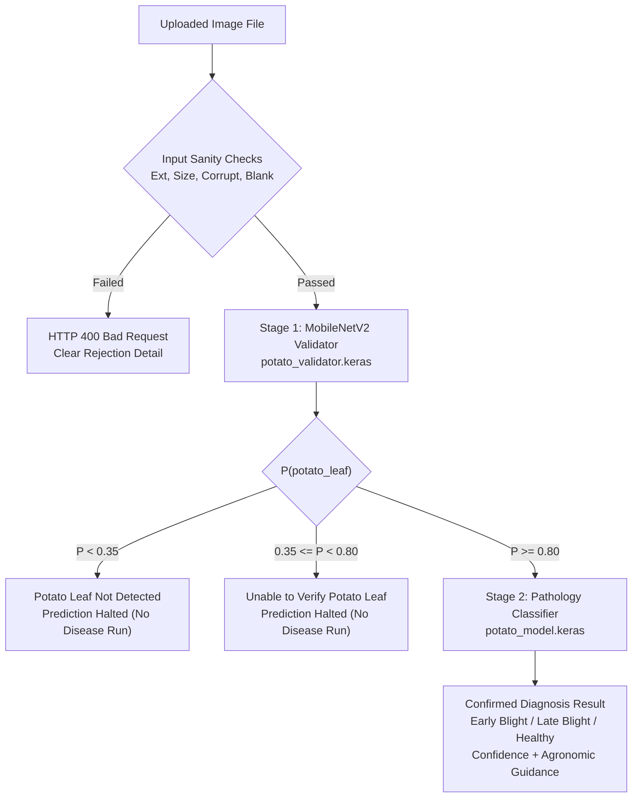

# Agent.md — Potato Doctor AI
## Comprehensive System Documentation & Two-Stage Botanical Validation

---

### 1. Main Objectives & Verification Summary

Build and maintain an end-to-end, scientifically defensible AI-based Potato Leaf Pathology diagnostic system using the native dataset already stored inside the open workspace folder.

**Strict Potato-Leaf Validation Mandate:**
1. **Potato leaves only:** Disease prediction is strictly gated behind an independent binary botanical validator. Diseases are predicted **only** when the uploaded image is verified as an authentic potato leaf.
2. **Separate validation model:** A standalone binary classifier (`models/potato_validator.keras`) differentiates `potato_leaf` vs `not_potato_leaf` independently of the 3-class disease classifier (`models/potato_model.keras`).
3. **Prediction workflow:** Two-stage sequential pipeline:
   - **Stage 1 (Botanical Validation):** Analyzes foliage morphology to verify *Solanum tuberosum*.
   - **Stage 2 (Pathology Classification):** Executes **only** if Stage 1 passes with high confidence ($P(\text{potato}) \ge 0.80$).
4. **Reject other plants:** If a tomato, corn, pepper, mango, or any non-potato leaf is uploaded, prediction is immediately halted with:
   > **Potato Leaf Not Detected**  
   > *“This image does not appear to show a potato leaf. Potato Doctor AI currently supports potato leaves only. Please upload a clear image of a potato leaf.”*
5. **Uncertain images:** If leaf morphology cannot be verified with high certainty ($0.35 \le P(\text{potato}) < 0.80$), disease diagnosis is withheld with:
   > **Unable to Verify Potato Leaf**  
   > *“We could not confidently verify that this is a potato leaf. Please upload a clear, well-lit image showing the leaf.”*
6. **Invalid images:** Blank/solid images, corrupt files, unsupported formats, and 0-byte uploads are cleanly intercepted and rejected with clear HTTP 400 error messages.
7. **No false confidence:** Never rely on the disease classifier's confidence to confirm crop species. Both thresholds and error boundaries are calibrated using a dedicated held-out test split.

---

### 2. Dataset Architecture & Separation

#### A. Native Potato Disease Dataset (Stage 2 Model)
Preserved untouched in `Potato dataset/Potato Diseases/`:
- **Total images:** 2,152 native images (256x256 RGB JPEG)
- `Potato___Early_blight`: 1,000 images
- `Potato___Late_blight`: 1,000 images
- `Potato___healthy`: 152 images
- **Splits:** 70% Train (1,506), 15% Val (322), 15% Held-Out Test (324).
- **Test Set Accuracy:** **97.22%** (Macro F1: 0.9577).

#### B. Curated Botanical Validation Dataset (Stage 1 Model)
Stored in `validation_dataset/` and indexed in `reports/validator_dataset_splits.json`:
- **Total images:** 820 balanced images (50% Potato, 50% Non-Potato)
  - **Positive (`potato_leaf`):** 410 images sampled evenly across Early Blight, Late Blight, and Healthy from the native dataset.
  - **Negative (`not_potato_leaf`):** 410 diverse samples:
    - *Other crop leaves (255 images):* Tomato (Early Blight, Late Blight, Leaf Mold, Healthy), Pepper (Bacterial Spot, Healthy), Corn (Common Rust, Healthy), Apple (Scab), Grape (Black Rot), Peach (Bacterial Spot) from `spMohanty/PlantVillage-Dataset`.
    - *Unrelated objects (130 images):* Real-world non-plant images (animals, vehicles, everyday objects, scenes) from `EliSchwartz/imagenet-sample-images`.
    - *Synthetic / Edge cases (25 images):* Blank solids, noise patterns, screenshots, UI diagrams, color gradients.
- **Stratified Splits:**
  - **Train:** 574 samples (287 pos, 287 neg)
  - **Validation:** 122 samples (61 pos, 61 neg)
  - **Held-Out Test:** 124 samples (62 pos, 62 neg: 38 other plant leaves, 20 unrelated objects, 4 edge cases)

---

### 3. Model Architecture & Threshold Calibration

#### Model Separation
1. **Disease Classifier (`models/potato_model.keras`):**
   - Size: 21.52 MB
   - Backbone: MobileNetV2 with fine-tuned top layers.
   - Classes: `Potato___Early_blight`, `Potato___Late_blight`, `Potato___healthy`.
2. **Binary Validator (`models/potato_validator.keras`):**
   - Size: 23.53 MB
   - Backbone: MobileNetV2 with GlobalAveragePooling2D, BatchNorm, Dense(128, relu, l2=1e-4), Dropout(0.35), Dense(1, sigmoid).
   - Output: $P(\text{potato\_leaf}) \in [0.0, 1.0]$.

#### Evaluation Metrics (Held-Out Test Set: 124 Unseen Samples)
- **ROC AUC:** **0.9971**
- **Selected Operational Threshold Policy:**
  - High Confidence Threshold ($\tau_{\text{high}}$): **0.80**
  - Low Rejection Threshold ($\tau_{\text{low}}$): **0.35**
- **Test Performance at High Threshold ($\tau = 0.80$):**
  - Accuracy: **94.35%**
  - Precision: **98.25%**
- **Subtype Score Distribution:**
  - `potato`: Mean score = 0.951. 90.32% passed $\ge 0.80$, 0.0% falsely rejected $< 0.35$.
  - `other_plant_leaf`: Mean score = 0.140. 89.47% strictly rejected $< 0.35$, only 2.6% above 0.80.
  - `unrelated_object`: Mean score = 0.009. 100.0% strictly rejected $< 0.35$, 0.0% false positives.
  - `edge_synthetic`: Mean score = 0.000. 100.0% strictly rejected $< 0.35$, 0.0% false positives.

---

### 4. End-to-End Decision Workflow

---

### 5. Frontend & UI Verification

The Vite React frontend (`frontend/`) features:
1. **Validation Rejection Cards (`frontend/src/components/ValidationRejectionCard.jsx`):**
   - Renders **Potato Leaf Not Detected** with exact prompt wording when non-potato crops or unrelated objects are uploaded.
   - Renders **Unable to Verify Potato Leaf** with exact prompt wording when blur/uncertainty threshold is triggered.
   - Completely omits disease diagnosis, healthy badges, or treatment plans for unverified uploads.
2. **State Reset Safety:**
   - Any new image drop, upload, or preset selection immediately resets previous prediction state.
3. **Quick Test Presets (`frontend/public/samples/samples.json`):**
   - Real Early Blight (Potato) -> Confirmed Diagnosis
   - Real Late Blight (Potato) -> Confirmed Diagnosis
   - Real Healthy Leaf (Potato) -> Confirmed Diagnosis
   - Tomato Leaf (Non-Potato) -> "Potato Leaf Not Detected"
   - Unrelated Object (Non-Plant) -> "Potato Leaf Not Detected"
   - Unclear / Blurry Leaf -> "Unable to Verify Potato Leaf"

---

### 6. Automated Integration Test Suite

Automated verification in `tests/test_local_system.py` executes 13 rigorous integration tests against the live API:
- `[TEST 1] GET /health`: Confirms both independent models loaded and operational.
- `[TEST 2] GET /classes`: Confirms active Potato scope and locked Coming Soon guards.
- `[TEST 3] POST /predict` (Potato Early Blight): Passed validation and diagnosed Early Blight (100%).
- `[TEST 4] POST /predict` (Potato Late Blight): Passed validation and diagnosed Late Blight (100%, Critical).
- `[TEST 5] POST /predict` (Potato Healthy): Passed validation and diagnosed Healthy (99.99%).
- `[TEST 6] POST /predict` (Tomato Leaf): Rejected with **Potato Leaf Not Detected** and exact required message.
- `[TEST 7] POST /predict` (Unrelated Object): Rejected with **Potato Leaf Not Detected**.
- `[TEST 8] POST /predict` (Unclear Specimen): Halted with **Unable to Verify Potato Leaf** and exact required message.
- `[TEST 9] POST /predict` (.txt file): Intercepted with HTTP 400 Bad Request.
- `[TEST 10] POST /predict` (0 bytes): Intercepted with HTTP 400 Bad Request.
- `[TEST 11] POST /predict` (Corrupted bytes): Intercepted with HTTP 400 Bad Request.
- `[TEST 12] POST /predict` (Blank white image): Intercepted with HTTP 400 Bad Request.
- `[TEST 13] Filesystem check`: Confirms separate models and configuration files.

**Test Result:** **13/13 tests passed with 100% success.**

---

### 7. Deployment Configuration

- **Frontend Deployment:** Vercel via root `vercel.json` pointing build commands to `npm --prefix frontend run build` and output to `frontend/dist`.
- **Backend Deployment:** Decoupled FastAPI server deployable to Render, Railway, AWS ECS, or Hugging Face Spaces.
- **Environment Variables:** `VITE_API_BASE_URL` in frontend; `CORS_ORIGINS` and optional `OPENAI_API_KEY` in backend.